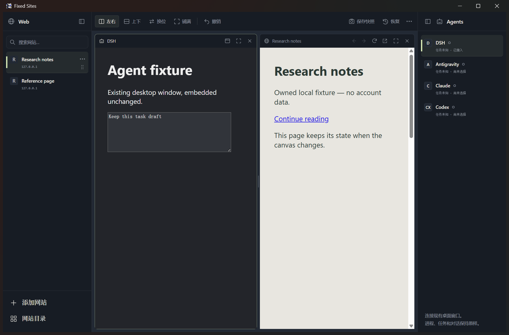

# FixedSites

FixedSites，简称 FS，是一个面向 Windows 的本地桌面工作区，用来集中打开常用网站，并接入已经运行的桌面 Agent 窗口。

左侧放网站，右侧放 Agents，中间显示正在使用的内容。你可以只看一个网页，也可以把两份资料并排，或者一边读文档、一边在 Agent 中工作。两侧栏分别收起后，更多空间会留给内容。

FS 保留网站本身的页面、登录流程和操作方式。Agent 也继续使用原来的桌面程序、对话与任务，FS 主要负责窗口接入、显示、布局和还原。

本文按 **v1.0.1（应用版本 1.0.1）** 的现有实现整理，涵盖项目介绍、全部主要功能、使用方式、数据存储与开发说明。v1.0.1 更新了安全依赖，功能范围与 v1.0 一致。



*上图使用本地测试网页和示例桌面窗口，不包含真实账号或对话。*

## 项目定位

FS 适合经常在几个固定网站和桌面应用之间切换的人。它把网站入口、网页内容和 Agent 窗口集中到一处，减少在桌面上寻找、排列和切换窗口的操作。

常见用法包括：

- 左边阅读技术文档，右边使用 Codex、Claude 等桌面应用。
- 同时打开两份资料，对照阅读、核实信息或比较页面。
- 将常用网站整理成自己的封面目录，按名称或网址找到入口。
- 手动保存一份页面与布局快照，之后恢复工作现场。

当前版本采用最多两个面板的布局，最多同时显示一个嵌入式 Agent。FS 不负责替 Agent 生成或执行指令，也没有账号管理中心、浏览器扩展系统和跨设备同步。

## 功能总览

| 模块 | 当前能力 |
| --- | --- |
| 常用网站 | 添加、修改、删除、搜索、排序、网站图标与自选封面 |
| 网站目录 | 错列封面布局、拖拽浏览、惯性滑动、缩放、键盘选择 |
| Explore | 按分类浏览内置网站入口，搜索并加入常用网站 |
| 中间工作区 | 单面板、左右／上下双面板、换位、比例调整、铺满与还原 |
| 网页操作 | 前进、后退、刷新、缩放、右键菜单、鼠标侧键、下载 |
| 独立网页窗口 | 独立最小化、导航栏、当前地址查看与复制、系统浏览器打开 |
| Agents | 接入已有桌面窗口、候选窗口预览、同步区域、断开还原、独立显示 |
| 状态显示 | 区分 Agent 进程状态、窗口接入状态和可确认的任务状态 |
| 撤销 | 撤销本次运行中最近一次网站清单或布局操作 |
| 手动快照 | 保存和恢复一份页面地址、布局、侧栏状态与主窗口位置 |
| 窗口管理 | 左右侧栏独立收起、沉浸模式、系统托盘、单实例运行 |
| 后台资源 | 按需创建网页、复用已有实例、后台节流、闲置页面回收 |
| 本地存储 | 网站清单、封面、偏好、快照、网页会话和 Agent 窗口配置 |

## 下载、启动与升级

在 [v1.0.1 Release](https://github.com/Arukasaeled/FixedSites/releases/tag/v1.0.1) 下载 `FixedSites-1.0.1-portable.exe`。当前提供 **Windows x64 便携版**，下载后直接运行。

Release 同时提供 `SHA256SUMS`，可用于核对程序文件。当前程序没有进行代码签名。

首次使用时，可以先从左侧添加常用网站。要接入 Agent，先在 Windows 中打开对应应用，再从右侧选择它的窗口。

升级时，从旧版托盘菜单选择「退出程序」，再启动新版。仅关闭主窗口可能只是隐藏到托盘。正常退出时，FS 会尝试将嵌入的 Agent 恢复为独立窗口，Agent 自身的进程和任务可以继续运行。

源码运行和便携版共用用户数据目录及单实例锁。如果已有实例运行，再次启动会唤醒旧实例，不会直接替换正在运行的代码。

## 常用网站管理

### 添加与修改

通过左侧「添加网站」填写名称和网址。网站入口支持 HTTP 和 HTTPS，未填写协议时会尝试补全。已经存在的相同规范化网址会复用已有条目，避免重复添加。

网站的操作菜单支持修改名称和地址。只修改名称不会重新加载页面；修改地址涉及页面实例替换，可能触发未保存内容的确认。

### 搜索、排序与删除

- 左侧搜索支持按名称、域名和网址筛选常用网站。
- 在侧栏搜索框按 Enter，可打开首个匹配项；按 Esc 可清除搜索。
- 使用条目上的拖拽手柄调整顺序，网站目录中的卡片也支持手柄排序。
- 搜索筛选期间暂停排序，清除搜索后恢复。
- 删除入口会从常用网站清单中移除该网站；如果相关页面仍有未保存内容，会按页面关闭规则处理。

网站清单的添加、修改、删除、排序和封面修改均属于一步撤销的覆盖范围。

### 网站图标与封面

默认使用网站 favicon；没有可用图标时显示替代标识。也可以为网站选择本地 PNG、JPEG、WebP 或 GIF 图片作为封面，之后再恢复为网站图标。

自选图片会复制到用户数据目录，清单只保存对应引用。FS 不依赖远程封面生成服务，也不会自动把已登录网页截图作为封面上传。

## 网站目录与 Explore

### My Sites 封面目录

「网站目录」以错列卡片展示常用网站。靠近视口中心的卡片会更突出，可以通过拖动和滚动浏览整组内容。

目录支持：

- 拖动背景或卡片正文平移视口，释放后进行短暂的惯性滑动。
- 使用滚轮浏览；按住 Shift 滚轮时横向移动。
- 使用 Ctrl＋滚轮或底部按钮缩放卡片。
- 通过底部导航或方向键选择卡片，按 Enter 打开。
- 使用 Home 或重置按钮回到初始卡片并重置缩放。
- 搜索网站、修改入口、删除条目、选择封面和拖动手柄排序。

浏览目录的拖动与调整顺序的拖动使用不同入口，避免平移时误改网站顺序。系统开启减少动态效果偏好时，目录会减少惯性和缓动。

目录缩放只影响卡片，不改变网页内容的缩放比例。从目录返回工作区时，仍然驻留的网页继续使用原来的实例。

### Explore 精选入口

Explore 提供随应用附带的网站清单，可按 **AI、开发、学习、设计、资讯** 分类筛选，也可以搜索名称、网址和描述。

点击添加按钮即可把入口加入自己的常用网站。已经添加的入口会显示对应状态，添加操作不会强制打断当前网页。

Explore 是本地预设清单，不是实时推荐服务。网站地址与内容由各自运营方维护，可能随时间变化。

## Web 与 Agent 双面板工作区

### 左右两侧栏

左侧 Web 栏用于选择和管理网站，右侧 Agents 栏用于选择桌面应用。两侧可以独立展开或收起，收起后保留图标入口。

中间工作区最多显示两个面板，支持一个网页、一个 Agent、两个不同的网站页面，或一个网页与一个 Agent。

同一个常用网站在当前实现中复用同一个实例，再次选择会回到已有页面，不会为同一条目创建第二个副本。切换 Agent 会替换当前展示的 Agent，不会形成两个同时显示的 Agent 面板。

### 排列、换位与调整大小

顶部工具栏提供「左右」和「上下」布局。出现空面板后，从侧栏选择要放入的内容即可。

点击「换位」，或者将一个面板标题拖到另一个标题上，可以交换位置。拖动中间分隔线可以调整比例；分隔线获得焦点后，也支持使用方向键微调。

「铺满」暂时展开当前面板，再点「还原」回到双面板。当前工作区是可调分栏，不是支持无限窗口自由叠放的画布。

布局操作会调整现有网页和原生窗口的显示区域，不通过重新打开网页或重启 Agent 来完成换位。

### 收起面板与沉浸模式

面板右上角的关闭按钮只收起该面板的显示。网页实例可能继续驻留，Agent 进程和任务也会继续运行；后台网页仍受闲置回收规则影响。

F11 可进入当前内容的沉浸模式，隐藏侧栏和工具栏；Esc 可恢复界面。沉浸模式与工具栏中的「铺满」不同，后者保留工作区的操作界面。

## 网页浏览与操作

### 导航与页面恢复

网页面板提供后退、前进、刷新和在系统浏览器打开当前页面的入口。网页本身的登录、链接、表单和交互继续由网站处理。

切换已驻留的网站时，FS 复用其网页实例，可以保留仍在内存中的阅读位置、输入和导航历史。首次打开、手动刷新、进程崩溃恢复或闲置回收后的重开，仍可能需要加载页面。

加载失败或网页进程退出时会显示相应状态，并提供重试或刷新入口。实际网站的加载时间还取决于网络和网站本身。

### 页面缩放

通过网页右键菜单或快捷键进行放大、缩小和恢复实际大小。当前缩放档位范围为 50%～300%。

缩放偏好按网站源保存，即协议、主机和端口的组合；下次导航到同源页面时会应用对应设置。这项缩放不用于控制嵌入式 Agent 的界面。

### 右键菜单

菜单根据当前点击位置提供不同操作：

- 在输入区域使用撤销、重做、剪切、复制、粘贴和全选。
- 复制选中的文字。
- 复制链接，或在系统浏览器打开允许的链接。
- 查看当前页面地址、复制当前页面 URL、在系统浏览器打开当前页面。
- 后退、前进、刷新，以及网页缩放。

「复制链接」针对点击到的超链接；「复制当前页面 URL」针对当前网页的实际地址，两者是不同操作。

### 下载与鼠标侧键

网页下载使用原生保存对话框，默认建议保存到系统下载目录，用户可以自行选择位置。下载中断时会提示返回网站重试；当前没有独立的下载管理中心。

鼠标侧键继续用于网页前进、后退。网页获得焦点时由 Chromium 处理；独立窗口的本地导航栏获得焦点时，操作会转给对应网页。

## 独立网页窗口

网站通过 `window.open`、`target="_blank"` 等方式打开的新页面，可以显示为独立窗口。

每个独立窗口带有一行简洁导航栏，提供后退、前进、刷新、只读的当前页面地址、复制地址、在系统默认浏览器打开当前地址，以及标题和加载或错误状态显示。

地址来自当前窗口实际使用的网页实例，导航、重定向和 SPA 路由变化后会更新，不固定为最初点击的链接。

独立窗口保留原生网页的 opener、POST 和共享 Session 机制，也支持嵌套弹窗。主窗口最小化时，独立网页窗口不会跟随最小化。

这类窗口仍由 FS 管理：退出整个程序时会关闭相关网页窗口；关闭上级弹窗时，也可能按现有关系一并处理其子弹窗。它们仍属于同一个 FS 应用的生命周期。

独立窗口支持 Ctrl＋W 关闭、F11 全屏，以及网页右键菜单和缩放。关闭时会处理网页提出的未保存内容确认。

## 桌面 Agent 接入

### 支持的预设与接入方式

当前提供 DSH、Antigravity、Claude 和 Codex 预设。FS 使用 Windows 原生窗口机制，把已有桌面窗口显示在工作区内。

使用步骤：

1. 在 Windows 中打开对应应用及需要使用的窗口。
2. 从右侧 Agents 栏选择该应用。
3. 如需选择具体窗口，打开窗口管理，查看候选预览并确认接入。
4. 与网页一起使用左右或上下布局。

FS 不需要配置这些应用的模型 API Key，也不负责登录它们的账号。账号、对话、模型选择和任务操作仍在原应用中完成。

### 窗口发现与管理

窗口管理界面支持刷新候选窗口、查看一次性预览、区分当前窗口和不可接入的候选项，并显示必要的窗口身份信息。

发现和预览不会自动启动目标应用，也不会为了截图而强制还原候选窗口。最小化窗口的预览可能是系统缓存画面，预览本身不等于已完成接入。

| 操作 | 作用 |
| --- | --- |
| 同步区域 | 重新同步原生窗口与当前显示区域，不重启应用 |
| 断开并还原 | 解除接入，尝试恢复接入前的位置、样式和窗口状态 |
| 独立显示 | 解除接入，并将原窗口独立显示在桌面上 |
| 重新选择 | 刷新候选列表后接入另一窗口 |

正常退出 FS 时，会先尝试还原嵌入窗口。还原失败时会保留宿主并提示重试，不会为了完成退出而直接结束 Agent 进程。

### 可选的启动路径

公开版不预置个人安装路径、固定窗口句柄或进程标识。默认方式是先手动打开应用，再选择窗口。

如果需要「启动并连接」，可先退出 FS，再在本机 `agents.json` 中为对应条目设置 `launchPath`，并保留其他字段。配置了启动路径后，界面才显示相应按钮。

不同应用的安装方式、版本、窗口重建和尺寸限制都可能影响嵌入效果。当前不支持任意桌面程序的通用拖入，也不同时展示两个嵌入式 Agent。

### 状态显示

FS 区分三类信息：进程是否运行、窗口是否接入，以及任务状态是否可确认。

任务状态可能显示为工作中、空闲或未知。现有状态观察器会在本机查询进程信息，并尝试读取 DSH、Antigravity 支持的只读状态接口；没有经过验证的状态来源时会显示未知，不会仅凭进程存在就判断任务正在运行或已经完成。

这项能力用于状态展示，不新增 Agent 任务完成提醒，也不让 FS 理解、编排或代替用户执行 Agent 对话中的工作。部分本地状态接口涉及目标应用的本地认证信息，具体边界见 [SECURITY.md](SECURITY.md)。

## 撤销上一步

顶部「撤销」只保留本次运行中最近一次受支持的操作，按钮提示会说明当前可撤销的内容。

覆盖范围包括网站添加、修改、删除、排序和封面修改，以及左右／上下排列、换位、比例调整、铺满、收起面板和快照恢复所涉及的布局操作。

每次新的受支持操作会替换上一步记录；撤销后不会形成多步历史或重做链。退出 FS 后，这份撤销记录不会保留。

它不用于撤销网页或 Agent 内部的输入、发送、提交和文件修改，也不承诺恢复已被销毁的网页内存状态。网页右键菜单中的文本撤销是另一项操作。

## 手动工作快照

点击「保存快照」可记录当前工作现场。快照需要用户主动保存，不会自动定时创建；界面只维护一份手动快照，再次保存会询问是否替换。

快照记录：

- 中间面板中的网站和 Agent 引用。
- 网站当时的实际页面地址，以及能够读取的页面顶层滚动位置。
- 左右或上下排列、分栏比例、当前面板和铺满状态。
- 两侧栏的收起状态。
- 主窗口的位置、大小和最大化状态。

保存后，重新启动 FS 仍可通过「恢复」读取这份快照。恢复的是可重建的工作现场，不是进程内存。

快照不包含独立弹窗的完整现场、网页表单、所有导航历史、网站自定义滚动容器、Agent 对话或任务执行状态。异步加载的网页可能无法准确回到原来的阅读位置。Agent 需要仍然可连接；快照引用的网站如果已从清单中删除，需要先撤销删除或重新保存快照。

## 后台资源与页面生命周期

网页按需创建，已经打开且仍驻留的页面会尽量复用。当前策略保留最近使用的五个网页实例，其余至少十五分钟未使用的页面才会成为回收候选；后台节流保持启用。

回收前会检查页面活动。正在画布中显示的页面，以及加载、媒体播放、下载、网络请求、弹窗、捕获权限、未保存输入或无法确认活动的页面，会受到保护。检查超时或状态不明确时，采用保留页面的策略。

因此，“保留五个”不是内存硬上限。受保护页面可能超过这个数量，FS 不会仅为达到固定内存数字而强制清理它们。

页面回收会丢弃其内存状态，之后可能需要从收藏入口重新加载；持久 Cookie 和本地站点存储仍留在原 Session。隐藏页面也不等于所有脚本和网络活动立即停止。

嵌入的 Agent 仍是原来的桌面进程。隐藏或收起 Agent 面板不会自动暂停它的任务，其 CPU 和内存使用仍取决于该应用。

## 托盘、关闭与退出

FS 提供系统托盘，主界面顶部的「…」也能打开相关菜单。菜单支持显示主窗口、隐藏主窗口、切换「关闭时最小化到托盘」和退出程序。

默认关闭主窗口会退出程序；开启「关闭时最小化到托盘」后，关闭按钮只隐藏主窗口，托盘「退出程序」仍会执行完整退出。

正常退出会检查网页未保存内容、等待配置保存、尝试恢复 Agent 窗口，再释放网页与托盘资源。用户取消关闭确认时，程序会保留当前工作。强制结束进程、断电等情况不属于正常退出流程，不能保证未提交内容得以恢复。

## 快捷键与鼠标操作

| 场景 | 操作 | 按键或手势 |
| --- | --- | --- |
| Web 工作区 | 切换前九个常用网站 | `Ctrl+1`～`Ctrl+9` |
| Web 工作区 | 上一个／下一个网站 | `Ctrl+Shift+Tab`／`Ctrl+Tab` |
| 主界面 | 展开／收起网站栏 | `Ctrl+\` 或 `Ctrl+Shift+B` |
| 主界面 | 切换沉浸模式 | `F11` |
| 沉浸模式 | 恢复界面 | `Esc` |
| 网页 | 后退／前进 | `Alt+←`／`Alt+→` 或鼠标侧键 |
| 网页 | 刷新 | `Ctrl+R` 或 `F5` |
| 网页 | 放大／缩小 | `Ctrl++`／`Ctrl+-` |
| 网页 | 恢复实际大小 | `Ctrl+0` |
| 独立网页窗口 | 关闭当前窗口 | `Ctrl+W` |
| 独立网页窗口 | 切换全屏 | `F11`，普通窗口全屏可用 `Esc` 退出 |
| 网站目录 | 选择上一张／下一张卡片 | 方向键 |
| 网站目录 | 打开当前卡片 | `Enter` |
| Explore | 添加当前卡片对应的网站 | `Enter` |
| 网站目录 | 回到初始卡片并重置缩放 | `Home` 或重置按钮 |
| 网站目录 | 平移视口 | 拖动或滚轮；`Shift+滚轮` 横向移动 |
| 网站目录 | 缩放卡片 | `Ctrl+滚轮` 或底部缩放按钮 |
| 分隔线 | 调整两栏比例 | 拖动，或聚焦后使用方向键 |

快捷键取决于当前焦点和界面状态。网页输入框、网站自己的全屏内容以及嵌入式 Agent 仍有各自的操作规则，表格不代表 FS 会接管所有应用的按键。

## 本地数据、备份与升级

用户数据位于 `%APPDATA%\FixedSitesBrowser`，不在便携 EXE 所在目录。

| 文件或目录 | 保存内容 |
| --- | --- |
| `sites.json` | 网站清单、当前选择及部分界面偏好 |
| `sites.json.bak` | 写盘时保留的上一份完整清单文件 |
| `manual-snapshot.json` | 用户主动保存的工作快照 |
| `agents.json` | 本机 Agent 配置、启动路径和窗口选择信息 |
| `agent-windows.json` | 原生窗口接入与恢复记录，生命周期由宿主管理 |
| `site-covers` | 用户自选的网站封面副本 |
| `Partitions\fixed-sites` | 网页持久会话数据 |

网页使用 `persist:fixed-sites` 共享 Session，主网页与独立弹窗沿用同一会话环境。同一站点的登录状态可以在正常使用中延续，但是否保持登录仍由网站的 Cookie、有效期和验证规则决定。共享 Session 不意味着不同网站可以越过同源限制读取彼此的数据。

网站配置采用串行写入：高频偏好变化会合并，替换正式文件前先写入临时文件并同步，再保留上一份完整文件。正常退出会等待保存完成。

`.bak` 是写盘备份，不是可浏览的多版本历史；后续写入会继续更新它。工作快照、一步撤销和文件备份也分别解决不同问题，不能相互替代。

备份网站清单时，先退出 FS，再复制清单文件；使用了自选封面时，也要保留 `site-covers`。完整用户目录可能含有登录会话和私人内容，应只保存在自己的备份位置，不要作为公开 Issue 附件。

更新或替换便携程序时沿用原数据目录，不需要清空 Cookie 或 Session。Git 仓库只管理源码，不能代替用户数据备份。

## 隐私与安全边界

- 项目没有内置云同步服务；网页仍会连接各自的网站。
- 远程网页关闭 Node.js 集成，使用 sandbox、contextIsolation 和网页同源规则。
- 本地控制界面通过受限 IPC 操作窗口，主进程检查发送方。
- 「在系统浏览器打开」只接受经过校验的 HTTP/HTTPS 地址。其他应用协议按现有规则确认，危险系统协议被拒绝。
- 受支持的摄像头、麦克风、通知、位置、剪贴板读取、屏幕共享等敏感权限按网站询问，授权范围为当前运行期间；请求还受网站来源和平台能力限制。
- 公开源码和程序不预置个人网站清单、Cookie、恢复副本、安装路径或固定窗口标识。

普通剪贴板写入、网页全屏等能力有各自的处理规则，不能将上述说明理解为“任何网站能力都一定弹窗询问”。详细说明和问题报告方式见 [SECURITY.md](SECURITY.md)。

## 当前范围与限制

- 当前提供 Windows x64 便携程序，原生 Agent 接入依赖 Windows 窗口机制。
- 中间最多两个面板、一个同时显示的 Agent，不支持无限窗口叠放或多个 Agent 同屏。
- Agent 接入是桌面窗口承载，不是模型 API 集成、对话同步或任务编排。
- 撤销只有本次运行的一步；快照只有一份手动保存的工作现场。
- 未提供账号管理、插件系统、云同步、浏览历史全文搜索、自动工作快照或 FS 自己的 Agent 完成提醒。
- 页面状态保留、权限能力和登录体验取决于网站与运行环境；无法保证所有网站和所有 Agent 版本的表现完全一致。
- 当前程序未进行代码签名。

## 技术架构

| 层次 | 实现与职责 |
| --- | --- |
| 桌面宿主 | Electron，管理主窗口、独立窗口、Session、IPC、托盘和生命周期 |
| 本地界面 | React，结合 Mantine、Radix UI、Tailwind CSS 和 daisyUI 构建侧栏、网站目录、表单与工作区控件 |
| 网页容器 | `WebContentsView`，按网站条目创建和复用网页实例 |
| 独立弹窗 | 原生窗口外框与本地导航栏，接入 Electron 原生创建的网页实例 |
| Agent 宿主 | C# 与 Windows 原生窗口接口，处理窗口发现、嵌入、尺寸同步和还原 |
| 本地存储 | JSON 配置、自选封面文件及 Electron 持久 Session |
| 构建 | esbuild、Tailwind CSS 与 electron-builder；便携启动模板有项目内的定制处理 |

主窗口的 React 界面、远程网页和 Agent 桌面进程分别承担自己的职责。布局变化主要调整容器与原生窗口的区域，网页内容和 Agent 本身不被改写为另一套界面。

## 从源码运行与构建

需要 Windows x64、Node.js 24 或更新版本，以及系统中的 .NET Framework C# 编译器。具体依赖版本记录在 `package.json` 和 `package-lock.json` 中。

```powershell
git clone https://github.com/Arukasaeled/FixedSites.git
cd FixedSites
npm ci
npm start
```

`npm start` 会先构建静态界面，再启动 Electron。构建脚本会在需要时编译原生窗口宿主。

构建 Windows 便携版：

```powershell
npm run dist:win
```

v1.0.1 的产物目录为 `dist/release-1.0.1/`。便携启动器使用版本独立的运行缓存，与用户数据目录分开，减少不同版本覆盖正在运行程序文件的风险。

### 本地检查

```powershell
npm run check:public
```

该检查针对 Git 索引中的文件，检查不应提交的运行数据、常见敏感路径和凭据格式、基本 JavaScript 语法、版本一致性，以及 README 中的本地链接和 Folia 致谢。尚未暂存的文档修改不会完整反映在这项索引检查中。

本地维护时可启用提交与推送前检查：

```powershell
git config core.hooksPath .githooks
```

窗口功能的定向检查：

```powershell
npm run test:canvas
```

该检查在 `test/runtime-*` 下创建独立配置、本地网页和临时示例窗口，不使用正式用户配置。运行目录、编译产物和用户数据不会提交到 Git。

### 主要源码目录

```text
src/
  main.js                 主进程、窗口、网页生命周期与功能入口
  preload.js              本地界面的 IPC 桥接
  canvas-layout.js        双面板几何布局
  config-writer.js        串行配置写入
  page-safety.js          页面活动与关闭检查
  agent-host.js           原生 Agent 宿主通信
  agent-observer.ps1      本地进程状态观察
  agent-task-status.js    支持的 Agent 只读任务状态查询
  agent-presets.json      公开版 Agent 预设
  native/                C# 原生窗口宿主
  popup/                 独立网页窗口的导航界面
  ui/                    React 界面与网站预设
scripts/                 界面构建、打包与源码发布检查
test/                    定向窗口检查和本地测试辅助文件
docs/                    文档使用的演示图片
```

## 灵感与致谢

**网站目录的拖拽界面灵感来自 [chthollyphile/folia-major](https://github.com/chthollyphile/folia-major)。** 错列封面布局、拖拽浏览和视口中心强调的设计参考了 Folia，感谢这个项目带来的启发。

FixedSites 使用 Electron、React、Mantine、Radix UI 等开源项目。第三方依赖、应用名称与素材的说明见 [THIRD_PARTY_NOTICES.md](THIRD_PARTY_NOTICES.md)。

## 许可证

本项目采用 [MIT 许可证](LICENSE)。第三方依赖和素材仍适用各自的许可证。
